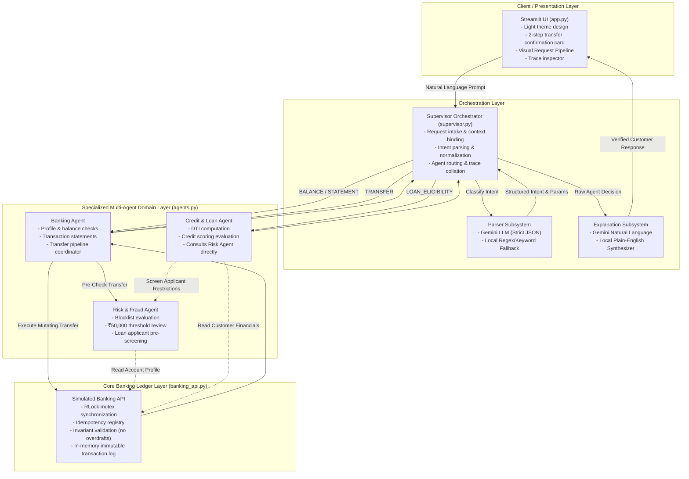

# Friends Bank — System Architecture & Design Document

> **Architecture Overview:** This document explains the internal design, agent communication contracts, safety invariants, and architectural trade-offs of the Friends Bank Multi-Agent System. It is written in an interview-friendly, technical depth suitable for engineering evaluations.

---

## 1. Architectural Philosophy & Objectives

In real-world institutional banking, autonomous AI cannot be granted unrestricted write access to core financial databases. Instead, robust systems separate **natural-language interaction** from **deterministic execution and ledger invariants**.

Friends Bank implements a **Supervisor-Worker Multi-Agent Architecture** coupled with an isolated **Core Banking Ledger Layer**:



---

## 2. Request Lifecycle & Orchestration Flow

Every interaction traverses five distinct stages:

### Stage 1: Context Binding & Ingestion
When a user submits a query or clicks a sample scenario button:
- The active customer ID (e.g., `C1001`) selected in the sidebar is injected as the session context.
- If the user uses a Quick Action button, the intent and extracted parameters are passed as `preparsed_intent`, completely bypassing parser latency while preserving traceability.

### Stage 2: Intent Classification & Parameter Normalization
The Supervisor routes the raw text prompt to the **Intent Parser**:
1. If `GEMINI_API_KEY` is present and reachable, Gemini (`gemini-2.5-flash`) extracts structured JSON adhering to the schema:
   ```json
   {"intent": "TRANSFER", "account_id": "C1001", "recipient_id": "C1003", "amount": 12000.0}
   ```
2. If the API key is absent, the network is down, or the model produces malformed output, the **Deterministic Local Parser** extracts parameters using compiled regular expressions and keyword pattern matchers.
3. If essential parameters for the identified intent are missing (e.g. transfer without recipient or amount), the Supervisor halts execution immediately with `NEEDS_INPUT`. It never makes dangerous assumptions about financial data.

### Stage 3: Specialized Agent Dispatch
The Supervisor dispatches the normalized request to the designated agent:
- `BALANCE` &rarr; `BankingAgent.get_balance(account_id)`
- `STATEMENT` &rarr; `BankingAgent.get_statement(account_id)`
- `TRANSFER` &rarr; `BankingAgent.transfer_funds(sender_id, recipient_id, amount, transaction_id)`
- `LOAN_ELIGIBILITY` &rarr; `CreditAgent.evaluate_loan_eligibility(account_id, proposed_emi)`
- `UNKNOWN` &rarr; Returns friendly service menu without invoking domain agents.

### Stage 4: Verified Multi-Agent Collaboration
During dispatch, specialized agents communicate directly:
- **Banking to Risk:** Before touching the ledger, the Banking Agent invokes `RiskAgent.pre_check_transfer()`.
- **Credit to Risk:** Before computing Debt-to-Income (DTI) metrics, the Credit Agent invokes `RiskAgent.screen_loan_applicant()`.

### Stage 5: Dual-Engine Explanation & UI Presentation
The raw data and status returned by the agents are passed to the **Explanation Subsystem**:
- If Gemini is active, it translates the raw decision into conversational, professional banking English without altering numeric values.
- If Gemini is inactive or errors, the local explanation engine generates clean, customer-facing text.
- The UI displays the status card, metrics/tables, live pipeline track, and full audit trace.

---

## 3. Deep-Dive: Inter-Agent Collaboration & Domain Agents

### Banking Agent (`BankingAgent`)
- **Isolation of Concerns:** The Banking Agent handles customer accounts and orchestrates fund transfers.
- **Safety Delegation:** It does not implement fraud logic itself; it delegates fraud and compliance checks entirely to the Risk Agent. If the Risk Agent returns `REVIEW_REQUIRED` or `BLOCKED`, the Banking Agent immediately returns that outcome without touching the ledger.

### Risk & Fraud Agent (`RiskAgent`)
- **Blocklist Screening:** Identifies flagged accounts (`is_blocklisted=True`). Blocklisted accounts (such as `C1002`) are blocked from all outgoing/incoming transfers.
- **Threshold Rule Enforcement:** Transfers exceeding ₹50,000.00 are flagged as `REVIEW_REQUIRED`. This halts automated transfer execution and mandates managerial review.
- **Loan Applicant Screening:** Exposes `screen_loan_applicant(account_id)` to audit loan applicants for existing compliance restrictions.

### Credit & Loan Agent (`CreditAgent`)
- **Genuine Cross-Agent Dependency:** In traditional siloed architectures, credit agents might only review credit score and income. In Friends Bank, the Credit Agent requires a security sign-off from the Risk Agent.
- **Collaboration Flow:**
  ```python
  # In CreditAgent.evaluate_loan_eligibility():
  # Step 1: Mandatory security check via Risk Agent
  risk_screen = self.risk_agent.screen_loan_applicant(account_id)
  if risk_screen.get("status") == "RESTRICTED":
      return {
          "status": "ON_HOLD",
          "message": "Loan application is on hold due to account restrictions.",
          "credit_score": profile["credit_score"],
          "dti": None,
          "risk_level": "RESTRICTED"
      }
  # Step 2: DTI & Credit Score Underwriting Heuristics
  dti = (total_obligations / monthly_income) * 100
  if credit_score >= 700 and dti <= 40.0:
      status = "APPROVED" # or ELIGIBLE
  ```
  This architectural link guarantees that restricted customer `C1002` (Rehan Thomas) cannot bypass compliance checks through the loan department.

---

## 4. Ledger Invariants & Safety Enforcement (`banking_api.py`)

Financial systems require defense-in-depth: the API ledger cannot rely solely on the AI layer for safety. The `BankingAPI` enforces strict invariants independently:

| Invariant | Mechanism | Failure Outcome |
| :--- | :--- | :--- |
| **No Overdrafts** | `if sender_balance < amount:` | `INSUFFICIENT_FUNDS` (Balances unchanged) |
| **Idempotency** | Global hash map keyed by `transaction_id` | Cached response returned; zero repeated deductions |
| **Replay Mismatch** | Compares cached payload vs incoming payload | `DUPLICATE_TRANSACTION_ID_MISMATCH` rejected |
| **Mutual Exclusion** | Python `threading.RLock()` around ledger mutations | Eliminates race conditions in concurrent transfers |
| **Self-Transfer Prevention** | `if sender_id == recipient_id:` | `INVALID_ACCOUNT` rejected |
| **Account Validation** | Checks existence of sender & recipient | `ACCOUNT_NOT_FOUND` rejected |
| **Value Sanity** | Validates `amount > 0` and is finite float | `INVALID_AMOUNT` rejected |

---

## 5. End-to-End Workflow Walkthrough: Two-Step Transfer

Here is an example trace of a user executing a standard transfer:

```
[User Action]
User inputs: "Transfer ₹12,000 to C1003" with active account C1001.

[UI Layer (app.py)]
1. Detects TRANSFER intent with recipient C1003 and amount 12,000.
2. Stages transfer in st.session_state.pending_transfer.
3. Renders amber Confirmation Card:
   "From: C1001 | To: C1003 | Amount: ₹12,000.00"
   Buttons: [✅ Confirm demo transfer] [❌ Cancel]
   *No ledger mutation has occurred.*

[User Confirmation]
User clicks [✅ Confirm demo transfer].

[Supervisor (supervisor.py)]
4. Generates unique client transaction ID: TXN_A1B2C3D4.
5. Invokes Banking Agent: transfer_funds('C1001', 'C1003', 12000.0, 'TXN_A1B2C3D4').

[Banking Agent (agents.py)]
6. Invokes Risk Agent: pre_check_transfer('C1001', 'C1003', 12000.0).
   -> Risk Agent verifies C1001 & C1003 are clean, amount (12,000) <= 50,000 threshold.
   -> Risk Agent returns: status="ALLOWED".

[Banking API (banking_api.py)]
7. Acquires RLock.
8. Verifies idempotency: TXN_A1B2C3D4 is new.
9. Checks C1001 balance: ₹125,000 >= ₹12,000.
10. Deducts ₹12,000 from C1001 (new balance: ₹113,000).
11. Credits ₹12,000 to C1003 (new balance: ₹20,500).
12. Appends immutable debit & credit records to transaction ledger.
13. Caches result in idempotency table.
14. Releases RLock.

[Response Generation]
15. Supervisor receives status="SUCCESS".
16. Passes outcome to Gemini (or Local Fallback) for natural explanation.
17. Pipeline visualizer highlights:
    Your Request (Completed) -> Coordinator (Completed) -> Banking Agent (Completed)
    -> Risk Agent (Completed) -> Credit Agent (Skipped) -> Gemini Response (Completed).
18. UI renders Success Card with updated balances.
```

---

## 6. Architecture Comparison: 48-Hour MVP vs Enterprise Reference

During system design reviews, an engineer must explain why certain technologies were selected over an enterprise reference stack:

| Architectural Component | Full Enterprise Banking Architecture | Friends Bank 48-Hour MVP | Engineering Rationale |
| :--- | :--- | :--- | :--- |
| **Agent Communication** | Distributed Async Message Broker (Kafka / RabbitMQ) | Synchronous In-Process Python Class Interfaces | Zero infrastructure overhead; predictable latency; 100% test deterministic repeatability. |
| **State & Persistence** | Distributed ACID Database (PostgreSQL / CockroachDB) | In-Memory Dictionary Ledger with Threading Locks (`RLock`) | Eliminates external database setup requirements for evaluation while enforcing exact ACID invariants. |
| **Service Discovery** | Kubernetes & gRPC Microservices | Modally Decoupled Python Modules (`agents.py`, `banking_api.py`) | Simple to run with standard `python` runtime on any platform without containerization hurdles. |
| **Agent Orchestration** | LangGraph / AutoGen / Temporal Workflow Engine | Custom Lightweight Supervisor (`supervisor.py`) | No heavy third-party framework abstraction bloat; complete control over fallback and audit traces. |
| **AI LLM Integration** | Enterprise Private Gateway with Semantic Caching | Google Gemini SDK (`gemini-2.5-flash`) + Deterministic Fallback | Direct, modern API access with a zero-downtime offline fallback mechanism. |

### Conclusion
The architecture deliberately mirrors institutional software design: **isolated responsibilities, immutable audit traces, fail-safe fallbacks, and deterministic ledger invariants**. It delivers enterprise-grade safety within a lightweight, beginner-friendly prototype.
