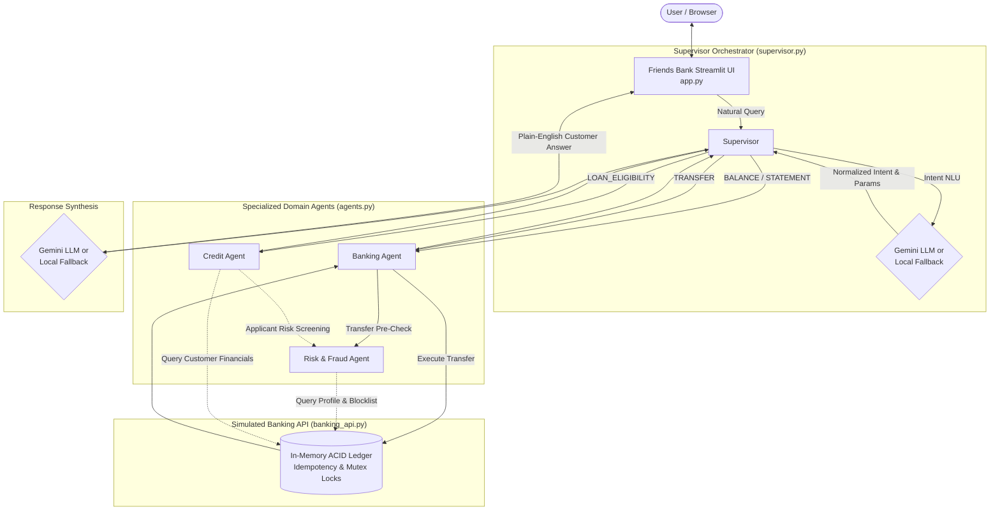

# Friends Bank — Application for Simulated Real-Time Banking Architecture with Multi-Agent Automation using Experimental Models

[](https://www.python.org/)
[](https://streamlit.io/)
[]()
[]()

> **Educational Prototype Notice:** Friends Bank is an experimental multi-agent banking prototype built for simulation, architecture evaluation, and research. All accounts, balances, credit ratings, and transactions are strictly simulated demo data in memory. This application is **not** a real banking institution and executes no real financial transactions.

---

## 1. Project Overview & Objective

Friends Bank demonstrates how specialized autonomous AI agents collaborate safely in a modern digital banking environment. Built with Python, Streamlit, and Google Gemini (with deterministic local fallbacks), the system showcases:

- **A Supervisor / Orchestrator Agent** that understands natural-language requests and routes them to domain specialists.
- **Three Specialized Agents** (Banking, Risk/Fraud, and Credit/Loan) with distinct responsibilities and inter-agent communication.
- **Genuine Agent Collaboration** (such as Credit Agent consulting Risk Agent prior to evaluating loan eligibility).
- **A Simulated Banking API** enforcing enterprise ledger safety, idempotency, fraud stops, and balance invariants.
- **Dual-Engine Intelligence** combining Gemini LLM plain-English understanding with a deterministic, zero-dependency local fallback.
- **A Distinctive Light-Themed UI** featuring a two-step transfer confirmation safety flow and a visual live agent execution pipeline.

---

## 2. Key Features & Supported Banking Use Cases

Friends Bank supports six core banking use cases:

| Use Case | Active Customer | Request Intent | Key Agents Involved | Expected Behavior |
| :--- | :--- | :--- | :--- | :--- |
| **Balance Inquiry** | `C1001` (Nila Varadhan) | `BALANCE` | Supervisor &rarr; Banking | Retrieves available demo balance (₹125,000.00). |
| **Transaction Statement** | `C1001` (Nila Varadhan) | `STATEMENT` | Supervisor &rarr; Banking | Retrieves chronological statement records and balance history. |
| **Standard Demo Transfer** | `C1001` &rarr; `C1003` | `TRANSFER` | Banking &rarr; Risk (Pre-check) &rarr; Banking API | Prompts for user confirmation; completes transfer of ₹12,000.00; balances update safely. |
| **High-Value Transfer Review** | `C1001` &rarr; `C1003` | `TRANSFER` | Banking &rarr; Risk (Threshold check) | Transfer of ₹65,000.00 triggers `REVIEW_REQUIRED` (amount > ₹50,000); funds remain unmoved. |
| **Loan Eligibility Screening** | `C1001` (Nila Varadhan) | `LOAN_ELIGIBILITY` | Credit &rarr; Risk (Applicant screen) | Checks credit score (760), DTI (21.4%), verifies zero restrictions; pre-approves loan. |
| **Restricted Loan Inquiry** | `C1002` (Rehan Thomas) | `LOAN_ELIGIBILITY` | Credit &rarr; Risk (Restriction screen) | Risk Agent identifies blocklisted/restricted account; loan halted with `ON_HOLD`. |

---

## 3. System Architecture

The following diagram illustrates the end-to-end request lifecycle and multi-agent interaction:



---

## 4. Multi-Agent Roles & Collaboration

### 1. Supervisor / Orchestrator Agent (`supervisor.py`)
- Acts as the single point of entry for user inquiries.
- Coordinates query understanding via Gemini LLM or the local parser.
- Validates required parameters without making unsafe guesses. If critical parameters are missing, returns friendly `NEEDS_INPUT`.
- Dispatches execution to the appropriate specialized agent.
- Formulates verified responses and captures a chronological `execution_trace` for auditability.

### 2. Banking Agent (`agents.py`)
- Manages customer account profiles, balances, and statement formatting.
- Handles fund transfer execution workflows.
- Mandates Risk Agent pre-approval before calling the banking ledger API.

### 3. Risk & Fraud Agent (`agents.py`)
- Evaluates account status against blocklist databases.
- Enforces transfer threshold rules: single transfers greater than ₹50,000.00 are flagged as `REVIEW_REQUIRED`.
- Blocks transfers to or from restricted/blocklisted accounts (`BLOCKED`).

### 4. Credit & Loan Agent (`agents.py`)
- Evaluates preliminary loan eligibility using Debt-to-Income (DTI) ratios and credit scoring.
- **Genuine Inter-Agent Collaboration:** The Credit Agent **never** evaluates loan terms in isolation. It actively invokes the Risk Agent (`risk_agent.screen_loan_applicant`) before computing credit metrics. If the applicant is flagged or restricted (e.g., account `C1002`), the loan request is placed `ON_HOLD` for security screening.

---

## 5. Simulated Banking API & Safety Invariants (`banking_api.py`)

The Banking API simulates an institutional core banking ledger with rigorous software engineering controls:

1. **In-Memory ACID Ledger:** Balances and transactions are stored with atomic balance mutations protected by reentrant threading locks (`threading.RLock`).
2. **Idempotency Protection:** Every transfer requires a unique client transaction ID (`TXN_...`). Repeating a transaction ID returns the cached original outcome and completely prevents double deductions. Reusing a transaction ID with mismatched parameters is rejected with an error.
3. **Balance Invariants:** Strict checks guarantee sender balances cannot fall below ₹0.00.
4. **Parameter Validation:** Validates positive, finite numerical amounts, valid existing account IDs, and prevents self-transfers (`sender != recipient`).
5. **Two-Step Confirmation Safeguard:** The user interface stages transfer requests for explicit user review ("Confirm demo transfer" vs "Cancel") before invoking the ledger mutation.

---

## 6. Dual-Engine Intelligence: Gemini LLM & Local Fallback

Friends Bank features a resilient dual-engine architecture:

```
                    ┌───────────────────────────┐
                    │  Customer Banking Prompt  │
                    └─────────────┬─────────────┘
                                  ▼
                     Is GEMINI_API_KEY valid &
                         network reachable?
                                ╱   ╲
                          YES  ╱     ╲  NO / Error
                              ▼       ▼
    ┌───────────────────────────┐   ┌───────────────────────────┐
    │     Google Gemini LLM     │   │  Deterministic Fallback   │
    │  - Strict JSON intent     │   │  - Regex & Keyword NLU    │
    │  - Natural plain English  │   │  - Pattern-based summary  │
    └─────────────┬─────────────┘   └─────────────┬─────────────┘
                  └───────────────┬───────────────┘
                                  ▼
                   Verified Multi-Agent Execution
```

- **Gemini Engine (`gemini-2.5-flash`):** Connected lazily through the official `google-genai` SDK. Interprets open-ended queries into structured intent JSON and translates raw agent outputs into courteous, natural explanations.
- **Local Fallback Engine:** A fast, deterministic Python parser and response generator. Runs automatically without requiring external API keys, network access, or external dependencies. Ensures zero downtime when offline or when API quotas are exceeded.

---

## 7. Windows Installation & Setup Guide

### Prerequisites
- Python 3.10 or higher (tested and verified on Python 3.14).
- Windows PowerShell or Command Prompt.

### Step-by-Step Installation

1. **Open PowerShell and navigate to the project directory:**
   ```powershell
   cd C:\Users\Logesh\Documents\Wrenchwiseassignment
   ```

2. **Create and activate a virtual environment:**
   ```powershell
   python -m venv .venv
   .\.venv\Scripts\Activate.ps1
   ```
   *(If script execution is disabled in PowerShell, run `Set-ExecutionPolicy -Scope Process -ExecutionPolicy Bypass` first, or activate in Command Prompt using `.\.venv\Scripts\activate.bat`)*

3. **Install dependencies:**
   ```powershell
   pip install -r requirements.txt
   ```

4. **Configure Environment Variables (Optional):**
   Copy `.env.example` to create your local `.env`:
   ```powershell
   copy .env.example .env
   ```
   Open `.env` and add your Gemini API key if desired:
   ```env
   GEMINI_API_KEY=your_gemini_api_key_here
   GEMINI_MODEL=gemini-2.5-flash
   ```
   *(Note: If you do not have an API key, leave `GEMINI_API_KEY` blank or omitted. Friends Bank will run automatically using its high-speed local fallback engine.)*

5. **Run the Application:**
   ```powershell
   python -m streamlit run app.py
   ```
   Open your browser to: **[http://localhost:8501](http://localhost:8501)**

---

## 8. Sample Prompts to Try

| Goal | Sample User Prompt | Expected Outcome |
| :--- | :--- | :--- |
| **Check Balance** | `"What is my current account balance?"` | Shows ₹125,000.00 for active customer Nila Varadhan (`C1001`). |
| **Transaction Statement** | `"Show my recent statement records"` | Displays formatted dataframe of 3 initial simulated transactions. |
| **Allowed Transfer** | `"Transfer ₹12,000 to C1003"` | Prompts for confirmation; updates sender balance to ₹113,000.00 and recipient to ₹20,500.00. |
| **Review Required** | `"Transfer ₹65,000 to C1003"` | Prompts for confirmation; halts with amber warning (`REVIEW_REQUIRED` > ₹50,000 threshold). No money moves. |
| **Loan Check (Approved)** | `"Check loan eligibility with ₹10,000 EMI"` | Credit Agent verifies 760 score, 21.4% DTI, and Risk clearance; pre-approves loan. |
| **Loan Check (Restricted)** | Switch active customer to `C1002`, then ask `"Can I get a loan with ₹5,000 EMI?"` | Risk Agent halts application with `ON_HOLD` due to account restriction. |
| **Unrecognized Query** | `"Can you buy 100 shares of Apple stock?"` | Returns friendly `UNKNOWN` notice explaining supported banking services. |

---

## 9. Automated Testing & Verification

The test suite provides comprehensive coverage for ledger invariants, agent workflows, supervisor routing, fallback resilience, and headless UI interactions.

Run the test suite via:
```powershell
python -m unittest discover -s tests -v
```

### Verified Test Suite Breakdown (53 Tests Total):
- **`tests/test_banking_api.py` (12 tests):** Validates initial balances, transactional consistency, duplicate idempotency caching, parameter mismatch rejection, overdraft protection, blocklist enforcement, and transfer threshold limits.
- **`tests/test_agents.py` (15 tests):** Validates Banking Agent balance/statement/transfer flows, Risk Agent threshold and blocklist checks, and Credit Agent DTI calculation and Risk Agent pre-check coordination.
- **`tests/test_supervisor.py` (15 tests):** Validates intent routing, parameter normalization, Gemini LLM parsing, graceful local fallback on network error/malformed JSON, and preservation of raw agent decisions.
- **`tests/test_app.py` (11 tests):** Headless AppTest validation of Streamlit UI initialization, button interactions, two-step transfer confirmation, rerun idempotency, cancellation safety, visual pipeline agent tracking, and ledger reset.

---

## 10. Known Prototype Limitations

1. **In-Memory Ledger:** Data resides in application memory and resets to initial baseline state when restarting the server or clicking "🔄 Reset Demo Ledger".
2. **Simulated Currency:** All balances and amounts represent fictional demo Indian Rupees (₹).
3. **Illustrative Underwriting Rules:** Credit scores, DTI thresholds, and loan pre-approvals are simulated heuristic models designed to illustrate multi-agent coordination rather than formal regulatory underwriting.
4. **Synchronous Execution:** Multi-agent coordination is orchestrated synchronously in Python for deterministic demo execution and test reproducibility.
