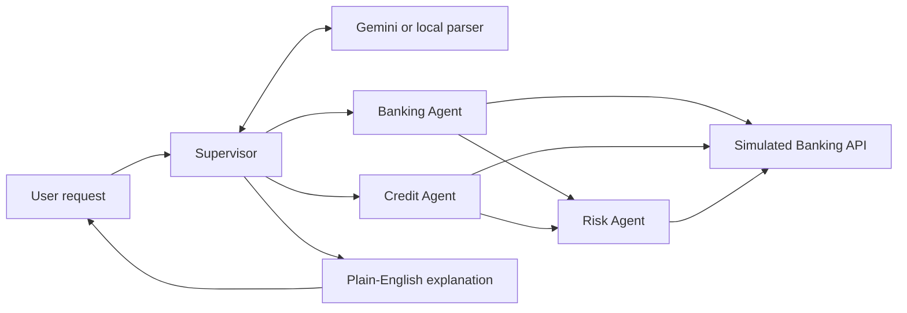

# Friends Bank 🏦- Application for Simulated Real-Time Banking Architecture with Multi-Agent Automation using Experimental Models

### A simulated banking environment powered by multi-agent AI

[](https://www.python.org/) [](https://streamlit.io/) [](https://ai.google.dev/gemini-api) [](#run-tests)

> **Demo only:** Friends Bank uses fictional customers and simulated money. It is not connected to a real bank and does not make real transactions or issue loans.

## What is Friends Bank?

Friends Bank is a small banking assistant that lets people ask questions in everyday English. A Supervisor routes each request to specialist agents, and the app presents the result in plain language.

It demonstrates how AI agents can work together while Python-based rules protect simulated banking operations.

## Features

- Check account balances and view transaction history.
- Stage and confirm simulated transfers.
- Flag transfers over **₹50,000** for review without moving money.
- Check sample loan eligibility using credit score and debt-to-income ratio.
- Use Gemini for request understanding and plain-English explanations, with a local fallback when Gemini is unavailable.
- View a visual pipeline showing which components handled a request.
- Run automated tests for banking rules, agents, routing, and the UI.

## Try these use cases

| Example request | Expected result |
|---|---|
| Check the balance for `C1001` | Shows the demo balance of **₹125,000** |
| View transactions for `C1001` | Shows the account's simulated transaction history |
| Transfer **₹12,000** from `C1001` to `C1003` | Requests confirmation, then transfers if all checks pass |
| Transfer **₹65,000** from `C1001` to `C1003` | Requires review; no money is moved |
| Check loan eligibility for `C1001` with a proposed EMI of ₹10,000 | Meets the illustrative score and affordability rules |
| Check loan eligibility for restricted account `C1002` | Places the request on hold for risk review |

## How it works



### The agents

| Component | Responsibility |
|---|---|
| **Supervisor** | Understands the request and selects the appropriate workflow. |
| **Banking Agent** | Retrieves account details and statements and coordinates transfer requests. |
| **Risk Agent** | Checks account restrictions and screens transfers. |
| **Credit Agent** | Evaluates sample loan eligibility and consults the Risk Agent. |
| **Banking API** | Rechecks transfer rules and updates the simulated ledger. |

Not every request uses every agent. For example, a balance inquiry normally uses the Banking Agent, while a loan check involves the Credit Agent consulting the Risk Agent.

## Safety rules in this demo

- Transfers must use valid accounts and a positive, finite amount.
- Transfers involving restricted accounts are rejected.
- Transfers above ₹50,000 are flagged for review.
- Transfers cannot exceed the sender's available balance.
- Transaction IDs help prevent duplicate transfers; reusing an ID with different details is rejected.
- Transfers require explicit confirmation in the UI.
- Loan checks use illustrative rules: credit score of at least **650** and debt-to-income ratio (DTI) no higher than **50%**.

These are demo rules, not real banking or lending policies.

## Tech stack

- **Python** — agent workflows and banking rules
- **Streamlit** — user interface
- **Google Gemini API** (`google-genai`) — natural-language interpretation and explanations
- **python-dotenv** — local environment configuration
- **unittest** and Streamlit `AppTest` — automated tests

## Run locally (Windows)

### 1. Open the project folder

```powershell
cd C:\Users\Logesh\Documents\Wrenchwiseassignment
```

### 2. Create and activate a virtual environment

```powershell
python -m venv .venv
.\.venv\Scripts\Activate.ps1
```

If PowerShell blocks activation, use Command Prompt and run:

```cmd
.venv\Scripts\activate.bat
```

### 3. Install dependencies

```powershell
python -m pip install -r requirements.txt
```

### 4. Configure Gemini (optional)

Create a local file named `.env` in the project folder and add your own key:

```dotenv
GEMINI_API_KEY=your_gemini_api_key_here
GEMINI_MODEL=gemini-3.8-flash
```

Get a key from [Google AI Studio](https://aistudio.google.com/apikey). Keep `.env` private and **never commit it to GitHub**. If Gemini is unavailable or its quota is exhausted, supported requests can use the local fallback.

### 5. Start Friends Bank

```powershell
python -m streamlit run app.py
```

Open [http://localhost:8501](http://localhost:8501) in your browser.

## Run tests

From the project folder, run:

```powershell
python -m unittest discover -s tests -v
```

The latest project report recorded **53 passing tests**. Run the command yourself after making changes to confirm the current result.

## Project files

```text
├── app.py                  # Streamlit interface
├── supervisor.py           # Request routing and explanation flow
├── agents.py               # Banking, Risk, and Credit agents
├── banking_api.py          # Simulated accounts and transfer rules
├── requirements.txt        # Python dependencies
├── .env.example            # Safe configuration template
├── .gitignore              # Excludes local secrets and caches
├── README.md               # Project guide
├── ARCHITECTURE.md         # Design details
├── DEMO_SCRIPT.md          # Demo walkthrough
└── tests/                  # Automated tests
```

## Limitations

- Account data is stored in memory and resets when the application restarts or the demo ledger is reset.
- Accounts, balances, transfers, and loan checks are simulated; no real bank is contacted.
- Credit decisions use simple example rules and are not financial advice or official lending decisions.
- Gemini access depends on model availability, network access, and API quota. The local fallback may provide the response instead.
- The agents run as components in one Python application; they are not independently deployed services.

## Assignment deliverables

- [x] Source code and automated tests
- [x] Setup instructions in this README
- [x] Architecture explanation — see [`ARCHITECTURE.md`](ARCHITECTURE.md)
- [x] Demo walkthrough — see [`DEMO_SCRIPT.md`](DEMO_SCRIPT.md)
- [ ] Add the published GitHub repository URL where you share the project
- [ ] Record and add the 5–10 minute demo video link

---

*Built as an educational MVP to demonstrate simulated banking workflows and multi-agent coordination.*
